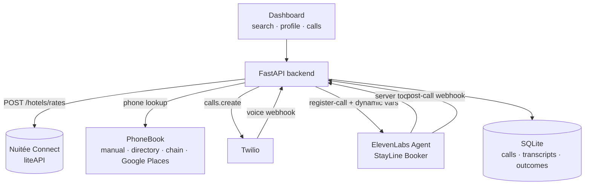

# StayLine — AI phone agent that books hotel rooms

StayLine searches **live hotel rates** (Nuitée Connect / liteAPI), finds the hotel's **phone
number**, then places a **real outbound phone call** through **Twilio** where an **ElevenLabs
AI agent** talks to the hotel's front desk and completes the booking — capturing the
confirmation number, total price, and cancellation policy as structured data.

This is the evolution of the QuoteDrive `voice_ai` approach (local Ollama + Whisper + Kokoro +
ADB-dialed phone). Instead of a fragile local pipeline, StayLine uses the ElevenLabs Agents
Platform for the full conversation stack (ASR, TTS, turn-taking, barge-in) and Twilio for
real telephony, orchestrated by a FastAPI backend with a web dashboard.

```
 search → enrich phone → place Twilio call → ElevenLabs agent talks → tools/webhooks → outcome stored
```

## What the data review found

The room-price results gathered by `hotel_api/` (liteAPI) contain hotel id, name, address,
city, stars, rating, photos and full rate details (price, room type, board, cancellation
policies) — **but no hotel phone numbers**. Neither `POST /hotels/rates` nor
`GET /data/hotels?hotelIds=...` returns contact numbers (verified live).

StayLine closes that gap with a phone enrichment layer:

1. **manual** — per-hotel override set from the dashboard or `PUT /api/hotels/{id}/phone`
2. **directory** — `data/hotel_phones.json` curated list (seeded with 555-style placeholders)
3. **chain** — brand reservation lines matched from the hotel name (Hilton, Marriott, ...)
4. **google** — optional Google Places lookup (`GOOGLE_PLACES_API_KEY`)

Every search result carries `phone` + `phone_source` so you always know where the number
came from. Chain reservation lines (real toll-free numbers) are only matched when
`ALLOW_CHAIN_DIALING=true`; successful Google lookups are cached per hotel in SQLite.

## Architecture



Call flow:

1. `POST /api/calls` stores the booking context (guest, hotel, dates, room, budget) and
   creates a Twilio outbound call to the hotel's number. The voice webhook URL points back
   at this server.
2. Twilio dials the hotel; when the hotel answers, Twilio hits `POST /twilio/voice/{call_id}`.
   The server calls ElevenLabs `POST /v1/convai/twilio/register-call` with the agent id and
   the booking context as **dynamic variables**, and relays the returned TwiML to Twilio —
   bridging the hotel straight onto the ElevenLabs agent.
3. The agent (see `app/prompts.py`) introduces itself as an automated assistant booking on
   behalf of the guest, answers the front desk's questions, asks for totals/policies, and
   calls its **server tools** (`/tools/record_reservation`, `/tools/report_outcome`) to save
   what it learns.
4. When the call ends, Twilio status callbacks mark it complete; the poller (and/or the
   ElevenLabs post-call webhook) fetches the transcript + analysis and stores it on the call
   record. The dashboard shows live status, transcripts, outcomes, and recordings.

## Three call modes

| Mode | Dials | Who answers | Use |
|---|---|---|---|
| `real` | the hotel's phone number — **only a verified source** (`manual` or `google`) | real front desk | production demo |
| `test` | `TEST_PHONE` (your cell) | you role-play the front desk | hear the agent live, cheap |
| `sim` | `TWILIO_SIM_NUMBER` (2nd Twilio number) | a second ElevenLabs agent playing front desk | full agent-to-agent demo |

`real` mode refuses to dial directory/chain numbers or anything unverified — set the number
explicitly (`PUT /api/hotels/{id}/phone` or the dashboard's "set phone" box) or configure
Google Places first. The default mode is `sim`.

`sim` mode turns two ElevenLabs agents loose on a Twilio leg each — the booker negotiates
with an AI receptionist that has rooms, rates and issues `SIM-XXXXXX` confirmations. Great
for demos with zero risk of bothering real hotels.

## Setup

```bash
cd stayline
python -m venv .venv
.venv\Scripts\activate
pip install -r requirements.txt
copy .env.example .env      # then fill it in
```

Fill in `.env`:

- `LITEAPI_KEY` — sandbox key (already prefilled from `hotel_api/.env`)
- `ELEVENLABS_API_KEY` — ElevenLabs dashboard → Profile → API Keys
- `TWILIO_ACCOUNT_SID`, `TWILIO_API_KEY_SID`/`TWILIO_API_KEY_SECRET` (or `TWILIO_AUTH_TOKEN`),
  `TWILIO_FROM_NUMBER` — Twilio console
- `TWILIO_SIM_NUMBER` (optional, for `sim` mode), `TEST_PHONE` (optional, for `test` mode)
- `PUBLIC_URL` — your public HTTPS URL (see below)
- `GOOGLE_PLACES_API_KEY` — optional, enables automatic hotel phone lookup
- `API_SECRET` — optional, locks mutating `/api/*` routes behind an `X-Api-Key` header

`WEBHOOK_SECRET` is generated automatically into `.env` on first run — no need to set it.

Create the agents (writes their IDs back into `.env`):

```bash
python scripts/setup_agents.py            # create/update both ElevenLabs agents
python scripts/setup_agents.py --list     # see what exists
```

Expose the server publicly (Twilio and ElevenLabs must reach the webhooks):

```bash
ngrok http 8010
# put the https URL into PUBLIC_URL in .env
python scripts/setup_agents.py            # re-run to attach server tools to the agents
```

Twilio number configuration (one-time, per number):

- `TWILIO_SIM_NUMBER`: Console → the number → Voice → "A call comes in" →
  **Webhook** `https://<PUBLIC_URL>/twilio/voice/frontdesk`, method **POST**
- `TWILIO_FROM_NUMBER` needs no webhook (outbound only)

Run:

```bash
python run.py             # http://127.0.0.1:8010
```

## Desktop test console (PyQt6)

`gui.py` is a PyQt6 app for testing the phone agent against your own phone:

```bash
python gui.py
```

- **Dialer** — type or keypad your number, press **CALL MY PHONE**, and the
  ElevenLabs agent calls you. You answer and role-play the front desk.
- **Booking scenario** — the hotel, suite, dates, and rate the agent will ask for
  (defaults match `CALL_SCRIPT.md`).
- **Guest profile** — the name/email/phone the agent gives the hotel.
- **Live call monitor** — status, transcript, and the reservation details the agent
  captures (confirmation #, dates, suite, total, cancellation, outcome).

Local requests (the GUI talks to `127.0.0.1`) may dial any test number; the public
ngrok tunnel cannot — it falls back to `TEST_PHONE` from `.env`.

**Role-play script:** read [`CALL_SCRIPT.md`](CALL_SCRIPT.md) while you answer —
it contains every line and number to give the agent (reference `GM-7QK482`,
Deluxe King Suite, $658.92 total, hold until 6 PM, cancellation terms) and what
to verify in the GUI afterward.

## Using the dashboard

1. **Search** — city, dates, guests → live rates with phone numbers
2. **Guest profile** — what the agent knows and may share (name, contact, budget, payment
   note, special requests). The agent never invents beyond this.
3. **Call mode** — pick `real` / `test` / `sim`
4. Press **Call to book** on a hotel. Watch call status, transcript, reservation details
   and the outcome appear as the call happens.
5. **Book online** — fallback that books the same offer through the liteAPI sandbox
   (prebook → book, simulated payment).

## API

| Method | Path | Purpose |
|---|---|---|
| GET | `/api/health` | config status chips |
| GET | `/api/hotels?city=&country=&checkin=&checkout=&adults=&limit=` | live rates + enriched phones |
| PUT | `/api/hotels/{hotel_id}/phone` | manual phone override (E.164) |
| GET/PUT | `/api/profile` | guest profile the agent uses |
| POST | `/api/calls` | place a booking call `{hotel_id, offer, mode}` |
| GET | `/api/calls`, `/api/calls/{id}` | call records with transcript/outcome |
| POST | `/api/calls/{id}/hangup` | end a call |
| POST | `/api/bookings/online` | liteAPI sandbox booking `{hotel_id, offer_id, ...}` |
| POST | `/twilio/voice/{call_id}` | Twilio voice webhook (relays ElevenLabs TwiML) |
| POST | `/twilio/voice/frontdesk` | Twilio voice webhook for the sim number |
| POST | `/twilio/status/{call_id}` | Twilio status callback |
| POST | `/twilio/recording/{call_id}` | recording URL callback |
| POST | `/tools/record_reservation` | ElevenLabs server tool |
| POST | `/tools/report_outcome` | ElevenLabs server tool |
| POST | `/webhooks/elevenlabs/post-call` | optional post-call transcription webhook |

## Tests

```bash
python -m pytest tests -v
```

Offline suite covers phone normalization, directory/chain lookup, Google Places parsing,
booking-context ↔ prompt variable coverage (so the agent never gets an empty `{{variable}}`),
the SQLite store lifecycle, TwiML/AMD helpers, and liteAPI response parsing against the real
fixtures in `../hotel_api/tests/responses/`.

## Security model

- **Twilio webhooks** (`/twilio/*`) verify `X-Twilio-Signature` with the auth token or API
  key secret; unsigned requests are rejected with 403.
- **Tool and post-call webhooks** (`/tools/*`, `/webhooks/elevenlabs/post-call`) require the
  `X-Webhook-Secret` header. The secret is **auto-generated into `.env` on first run**;
  agents created by `scripts/setup_agents.py` send it automatically. If you wire the
  ElevenLabs post-call webhook manually, add the same header to its request headers.
- **`API_SECRET` (optional)** — when set, all mutating `/api/*` routes require an
  `X-Api-Key` header (enter it in the dashboard header input).
- `POST /api/calls` never dials an arbitrary number: real mode only dials the selected
  hotel's verified number, and `real`/`test`/`sim` targets come from `.env`.
- Recording URLs are validated (`https://` on a `twilio.com` host) before being stored or
  rendered, blocking `javascript:` link injection.
- The public tunnel still exposes `GET /api/*` (dashboard data) by design; for anything
  beyond a demo, run `ngrok http --basic-auth user:pass 8010` or set `API_SECRET`.

## Safety notes

- The agent always discloses it is an automated assistant calling on behalf of a guest.
- It never reads out card numbers; payment is handled per the profile's payment note
  (default: card at check-in).
- `data/hotel_phones.json` ships 555-style placeholder numbers and chain lines are gated
  off by default — `real` mode only dials numbers you set yourself or Google verifies.
- `RECORD_CALLS=true` enables Twilio recording; recordings are stored on the call record.
- The voice webhook is idempotent: a Twilio retry reuses the stored TwiML instead of
  creating a second ElevenLabs conversation.
